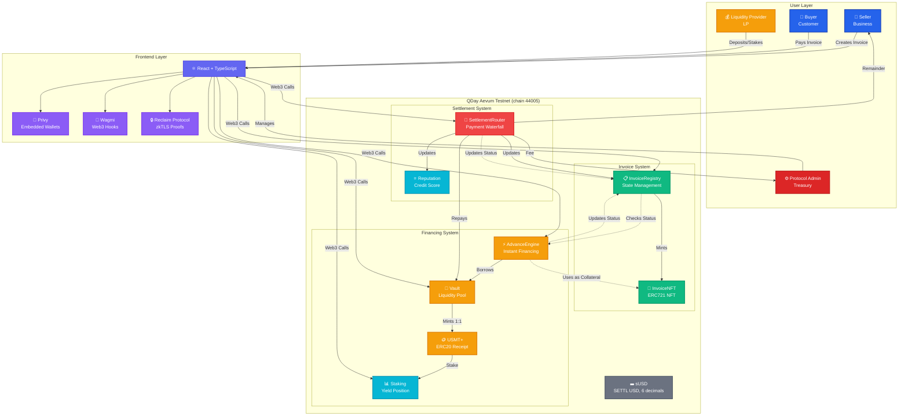
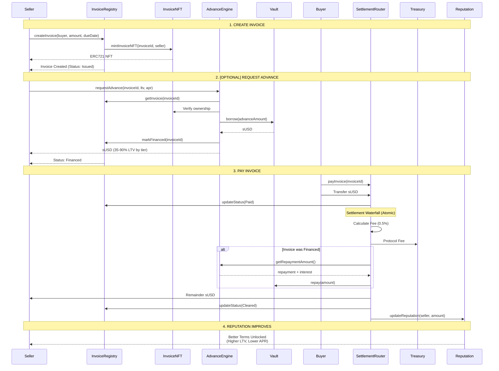
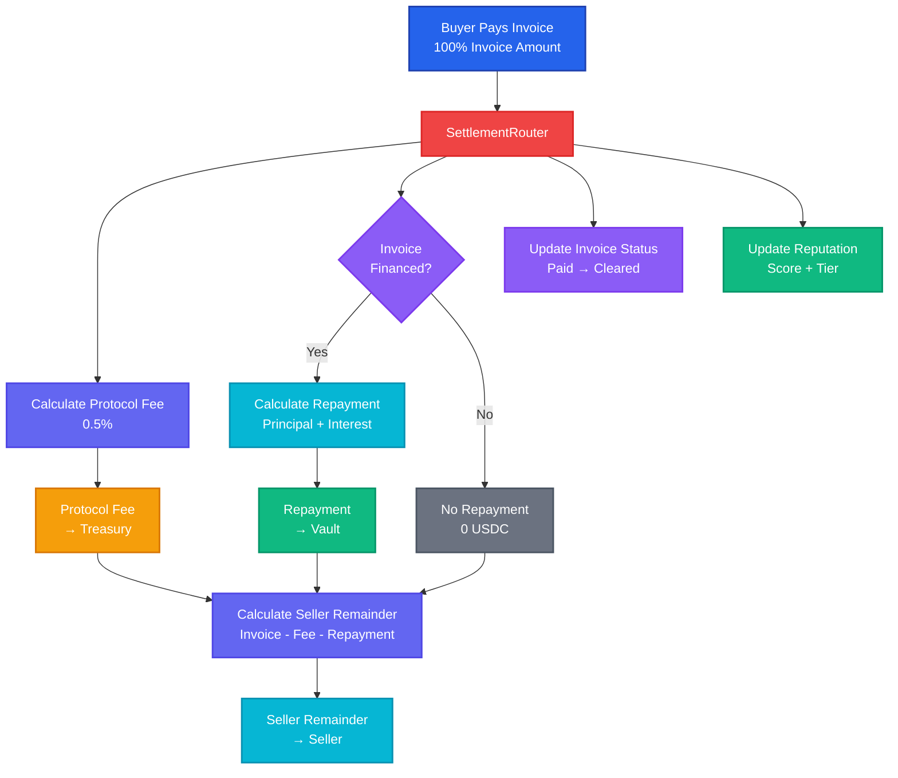

# SETTL.


SETTL. is a Stripe-like invoice link that turns accounts receivable into on-chain cash flow on the **QDay Aevum testnet**. A seller sends an invoice link, takes an instant advance against it from a shared liquidity pool, and gets the rest when the buyer pays. One payment settles the protocol fee, the pool and the seller in a single transaction, and every cleared invoice raises the seller's on-chain reputation, which unlocks larger advances.

Built for the [Aevum Builder Challenge #1](https://dorahacks.io/hackathon/2442), Invoice Payments track.

For a detailed introduction, see [INTRO.md](./INTRO.md).

## 🚀 Live on Aevum testnet

Deployed on 16 Nov 2026 to QDay Aevum Testnet (chain ID `44005`). Full record, including deploy and role-wiring transactions: [`deployments/44005.json`](./deployments/44005.json).

| Contract | Address |
|---|---|
| sUSD (SETTL USD, settlement token) | [`0x45D371fC414ab30bc6B88AB9B31A8c7d87691B68`](https://explorer-test.qday.info/address/0x45D371fC414ab30bc6B88AB9B31A8c7d87691B68) |
| InvoiceNFT | [`0x4E27DBAA6eD92eB9303E9e108d6894263400580F`](https://explorer-test.qday.info/address/0x4E27DBAA6eD92eB9303E9e108d6894263400580F) |
| InvoiceRegistry | [`0x035eEBb0892bd4132daF097ad072A04790699b72`](https://explorer-test.qday.info/address/0x035eEBb0892bd4132daF097ad072A04790699b72) |
| USMTPlus | [`0xd6301d6d7D4692568463D92d09Ae93C0511B85BB`](https://explorer-test.qday.info/address/0xd6301d6d7D4692568463D92d09Ae93C0511B85BB) |
| Vault | [`0xC3fc88D2bC63A258c8E33bc6F8BdE67768f47A90`](https://explorer-test.qday.info/address/0xC3fc88D2bC63A258c8E33bc6F8BdE67768f47A90) |
| Staking | [`0x66291730F13b5C767C6f2Bf5F8929115dF74EB50`](https://explorer-test.qday.info/address/0x66291730F13b5C767C6f2Bf5F8929115dF74EB50) |
| AdvanceEngine | [`0xf72e2816022DE208E2E9db091ae8cA9e325dCd82`](https://explorer-test.qday.info/address/0xf72e2816022DE208E2E9db091ae8cA9e325dCd82) |
| Reputation | [`0x68c0AE260CF6ECC8586D348074Eb974162EDE5D2`](https://explorer-test.qday.info/address/0x68c0AE260CF6ECC8586D348074Eb974162EDE5D2) |
| SettlementRouter | [`0x8b2f960D7092933a8366f4c9496853B9491a7ee6`](https://explorer-test.qday.info/address/0x8b2f960D7092933a8366f4c9496853B9491a7ee6) |

Protocol fee: 0.5% (50 bps), sent to the treasury on every settlement.

---

## 🏗️ Architecture

### System Overview



### Invoice Lifecycle Flow



### Liquidity Provider Flow

```mermaid
flowchart LR
    Start([LP Starts]) --> Deposit[Deposit USDC<br/>to Vault]
    Deposit --> Receive[Receive USMT+<br/>1:1 Receipt Token]
    
    Receive --> Choice{Stake?}
    Choice -->|Yes| Stake[Stake USMT+]
    Choice -->|No| Hold[Hold USMT+<br/>Liquid Position]
    
    Stake --> ReceiveStake[Receive sUSMT+<br/>Staked Token]
    ReceiveStake --> Earn[Earn 15-25% APY<br/>From Borrower Repayments]
    
    Hold --> EarnSimple[Earn from<br/>Vault Utilization]
    
    Earn --> WithdrawStake[Unstake sUSMT+]
    EarnSimple --> Withdraw[Withdraw USDC]
    WithdrawStake --> Withdraw
    
    Withdraw --> Burn[Burn USMT+<br/>Receive USDC]
    Burn --> End([Exit])
    
    style Start fill:#6b7280,stroke:#4b5563,stroke-width:2px,color:#fff
    style Deposit fill:#10b981,stroke:#059669,stroke-width:2px,color:#fff
    style Receive fill:#f59e0b,stroke:#d97706,stroke-width:2px,color:#fff
    style Choice fill:#6366f1,stroke:#4f46e5,stroke-width:2px,color:#fff
    style Stake fill:#06b6d4,stroke:#0891b2,stroke-width:2px,color:#fff
    style Hold fill:#8b5cf6,stroke:#7c3aed,stroke-width:2px,color:#fff
    style ReceiveStake fill:#06b6d4,stroke:#0891b2,stroke-width:2px,color:#fff
    style Earn fill:#ef4444,stroke:#dc2626,stroke-width:2px,color:#fff
    style EarnSimple fill:#f59e0b,stroke:#d97706,stroke-width:2px,color:#fff
    style WithdrawStake fill:#6366f1,stroke:#4f46e5,stroke-width:2px,color:#fff
    style Withdraw fill:#2563eb,stroke:#1e40af,stroke-width:2px,color:#fff
    style Burn fill:#10b981,stroke:#059669,stroke-width:2px,color:#fff
    style End fill:#6b7280,stroke:#4b5563,stroke-width:2px,color:#fff
```



### Settlement Waterfall



---

##Quick Start

### Installation

```bash
# 1. Clone the repository
git clone https://github.com/builderbroxd/mysettl.git
cd mysettl

# 2. Install dependencies
npm install

# 3. Compile contracts first (optional, deploy script will compile)
npm run compile

# 4. Set up environment variables
cp .env.example .env  # Create .env file and fill in your values

# 5. Start development server
npm run dev
```

The development server will start on `http://localhost:8080`

---

## 📋 Detailed Setup Instructions

### Step 1: Clone Repository

```bash
git clone https://github.com/builderbroxd/mysettl.git
cd mysettl
```

### Step 2: Install Dependencies

```bash
npm install
```

This installs:
- Frontend dependencies (React, Vite, TypeScript, Wagmi, etc.)
- Smart contract dependencies (Hardhat, Ethers.js, OpenZeppelin)
- All required packages listed in `package.json`

### Step 3: Environment Configuration

Create a `.env` file in the root directory by copying `.env.example`:

```bash
cp .env.example .env
```

Then fill in your environment variables. See `.env.example` for all required variables.

**Environment variables:**

- `VITE_PRIVY_APP_ID`: from the [Privy Dashboard](https://dashboard.privy.io/)
- `AEVUM_RPC_URL`: optional, defaults to `https://rpc-test.qday.info`
- `DEPLOYER_PRIVATE_KEY`: testnet-only key, needed only to deploy contracts
- `VITE_*_ADDRESS`: contract addresses. `.env.example` already holds the live Aevum deployment, so the app works without deploying anything.
- `VITE_RECLAIM_APP_ID` / `VITE_RECLAIM_APP_SECRET`: optional, for zkTLS proofs via Reclaim Protocol

**Important:** Never commit your `.env` file. It is already in `.gitignore`.

### Step 4: Connect to QDay Aevum Testnet

1. Add the network to your wallet:
   - **Network Name:** QDay Aevum Testnet
   - **RPC URL:** https://rpc-test.qday.info
   - **Chain ID:** 44005
   - **Currency Symbol:** tQDAY
   - **Block Explorer:** https://explorer-test.qday.info
2. Get tQDAY for gas from the [QDay faucet](https://faucet.qday.info/en).
3. Mint test sUSD in the app under **Settings**. sUSD can only be minted on test chains.

---

## 🏗️ Smart Contract Deployment

### Deploy All Contracts

```bash
npm run deploy:aevum
```

`scripts/deploy-aevum.cjs` refuses to run on any chain other than Aevum (44005) or a local Hardhat node, then:

1. Deploys **sUSD** (SETTL USD), the mintable 6-decimal demo stablecoin. Set `STABLECOIN_ADDRESS` to settle in an existing 6-decimal token such as tUSD8 instead.
2. Deploys **InvoiceNFT**, **InvoiceRegistry**, **USMTPlus**, **Vault**, **Staking**, **AdvanceEngine**, **Reputation** and **SettlementRouter** (0.5% protocol fee).
3. Wires the roles between them (minters, settlement router, advance engine, vault borrower).
4. Prints the `VITE_*_ADDRESS` lines to paste into `.env`.

Every confirmed step is written to `deployments/44005.json`, so an interrupted run can be resumed by running it again. To start a completely fresh deployment, move that file aside first.

### Verify Contracts (Optional)

After deployment, verify contracts on Mantle Explorer:

```bash
# Set your Mantle Etherscan API key in .env
MANTLE_ETHERSCAN_API_KEY=your_api_key

# Verify contracts
npm run verify
```

This requires:
1. Mantle Etherscan API key (get from [Mantle Explorer](https://explorer.testnet.mantle.xyz))
2. Contracts to be fully confirmed on-chain

### Manual Deployment (Advanced)

For more control, deploy contracts individually:

```bash
# Using Hardhat console
npx hardhat console --network mantleSepolia

# Or create custom deployment script
# See scripts/deploy-all.ts for reference
```

---

## 🎨 Frontend Deployment

### Development Mode

```bash
npm run dev
```

Starts Vite dev server with hot reload on `http://localhost:8080`

### Production Build

```bash
# Build for production
npm run build

# Preview production build locally
npm run preview

### Testing the Complete Flow

1. **Deploy Contracts:**
   ```bash
   npm run deploy
   ```

2. **Start Frontend:**
   ```bash
   npm run dev
   ```

3. **Fund Wallets:**
   - Use Settings → Demo Setup to mint DemoUSDC
   - Fund test wallets with DemoUSDC

4. **Test Invoice Flow:**
   - Create invoice as Seller
   - Request advance (optional)
   - Pay invoice as Buyer
   - Verify settlement waterfall

---

## 📚 Architecture Overview

### Smart Contracts

```
InvoiceRegistry
    ├── Creates invoices
    └── Mints InvoiceNFT (ERC721)

InvoiceNFT
    └── Represents tokenized invoices

Vault
    ├── Accepts LP deposits (USDC)
    ├── Mints USMT+ (1:1 receipt token)
    └── Provides liquidity for advances

Staking
    ├── Accepts USMT+ deposits
    ├── Mints sUSMT+ (staked receipt token)
    └── Targets 15-25% APY yield

AdvanceEngine
    ├── Uses InvoiceNFT as collateral
    └── Borrows from Vault

SettlementRouter
    ├── Handles invoice payments
    ├── Executes settlement waterfall:
    │   ├── Protocol fee (0.5%)
    │   ├── Vault repayment (if financed)
    │   └── Seller remainder
    └── Updates Reputation

Reputation
    └── Tracks on-chain credit scores
```

### Frontend Architecture

```
React + TypeScript
    ├── Privy (Embedded Wallets)
    ├── Wagmi (Web3 Interactions)
    └── Reclaim Protocol (zkTLS proofs - optional)
```

## 🔐 Security Considerations

### For Users

- **Non-Custodial:** SETTL does not hold user funds; all transactions are on-chain
- **Smart Contracts:** All contracts use OpenZeppelin libraries and best practices
- **Audits:** Contracts should be audited before mainnet deployment
- **Testnet Only:** Current deployment is on Mantle Sepolia testnet

### For Developers

- **Private Keys:** Never commit private keys to version control
- **Environment Variables:** Keep `.env` secure and never share it
- **Contract Upgrades:** Current contracts are not upgradeable (immutable)
- **Access Control:** Uses OpenZeppelin's AccessControl for role-based permissions

---

## 🤝 Contributing

SETTL is currently in active development. For contributions:

1. Fork the repository
2. Create a feature branch
3. Make your changes
4. Test thoroughly
5. Submit a pull request

---

## 📄 License

© 2024 SETTL.. All rights reserved.

---

## 🌐 Learn More

- **Introduction:** See [INTRO.md](./INTRO.md) for project overview and pitch
